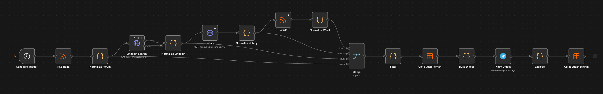

# Job Radar - n8n

Collects n8n and automation job postings from four sources twice a day, removes duplicates and noise, and sends a ranked digest to Telegram.

## Problem

n8n and automation roles are scattered across a forum, LinkedIn, two job boards and a remote-work board. Checking them by hand every day takes time, and the same role shows up on several sites with different URLs.

## How it works

1. **Schedule Trigger** fires at 10:00 and 22:00 Asia/Jakarta.
2. **Four sources** are fetched: n8n community forum RSS, LinkedIn guest jobs API, Jobicy API, WeWorkRemotely RSS.
3. **Normalize** code nodes map every source to one shape: title, company, location, url, published date, source.
4. **Merge** (append) combines the streams.
5. **Filter** drops senior-level titles, "for hire" posts and anything older than 14 days, then scores each item.
6. **Cek Sudah Pernah** checks a Data Table (`job_radar_seen`) so nothing is sent twice.
7. **Build Digest** assembles up to 15 jobs with a per-source quota, so one noisy source cannot crowd out the others.
8. **Kirim Digest** sends it to Telegram. Only after a successful send does **Catat Sudah Dikirim** write the URLs into `job_radar_seen`. If the send fails, the jobs stay unseen and are retried on the next run.

## Results

- **54** unique jobs recorded since 9 October 2026.
- **23 of 28** scheduled runs succeeded, with a mean run time of **11.7 s** for four sources.
- Mean run time dropped from **49 s to 6 s** after the per-item execution fix below.
- An error workflow notifies Telegram automatically when any node fails.

## Stack

n8n 2.39.8 self-hosted (Docker), Telegram Bot API, LinkedIn guest jobs API, Jobicy API, RSS, n8n Data Tables.

## Import

1. Download `job-radar.json`.
2. In n8n: Workflows -> Create Workflow -> **...** menu -> Import from File.
3. Create your own Telegram Bot credential and select it in **Kirim Digest**.
4. Create a Data Table named `job_radar_seen` with columns `url`, `title`, `source`, `first_seen` (all string).
5. Set the workflow Timezone to `Asia/Jakarta` under the **...** menu, then Execute once.
6. Publish.

## What I learned

- An HTTP node that receives N items runs **once per item**. In the first version each downstream source re-fetched everything: LinkedIn made 25 requests per run and WeWorkRemotely returned 1,000 items. Turning on **Execute Once** cut LinkedIn to 1 request and the whole run from 49 s to 6 s.
- Misplaced ordering breaks deduplication. Recording URLs before the Telegram send looks harmless, but a failed send then loses those jobs forever. Send first, record second.
- Hiding a failing source behind "continue on error" is worse than fixing it. The source silently disappears from the digest and nothing tells you.
